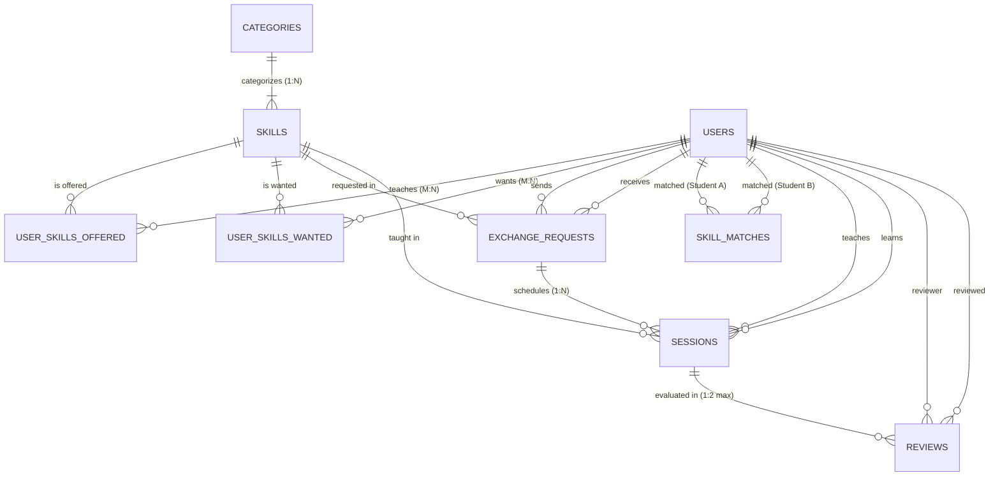

# SkillSync – Campus Skill Exchange Platform 🎓

> **Course:** Database Management Systems (DBMS) – Project-Based Learning (PBL)  
> **Team Scope:** 3-Person 3rd-Year B.Tech / B.E. Project  
> **Database:** MySQL 8.0 (InnoDB Storage Engine)  
> **Tech Stack:** React 19 + Vite + Tailwind CSS | Node.js + Express.js | MySQL 8.0

---

## 📌 1. Database Overview

**SkillSync** is a peer-to-peer campus platform where college students trade skills without money. A student who excels at **Java** and **React** can exchange knowledge with a peer fluent in **Python** or **MySQL Database Design**.

The database architecture is designed specifically for **academic DBMS PBL evaluation**, prioritizing:
- **Strict 3NF Normalization**: Every non-key attribute is dependent on the primary key, the whole primary key, and nothing but the primary key. Derived attributes such as average ratings are calculated dynamically via SQL views.
- **Relational Integrity**: 9 distinct tables with composite primary keys, check constraints, foreign keys with explicit cascading rules, and unique constraints.
- **Bidirectional Relational Matchmaking**: Pure SQL multi-way self-joins detecting two-way skill matches.
- **ACID Transactions**: Pessimistic row-locking (`FOR UPDATE`) for atomic session booking and request status progression.
- **Database Triggers**: Workflow consistency and business rule enforcement.

---

## 🗄️ 2. Database Schema & Tables

The database name is **`skillsync_db`**. It comprises 9 core tables:

| Table | Primary Key | Foreign Keys | Key Constraints & Rules |
| :--- | :--- | :--- | :--- |
| **`users`** | `user_id` (PK, Auto-Inc) | None | `college_email` UNIQUE, `role` ENUM('student', 'admin'). No derived `avg_rating` stored. |
| **`categories`** | `category_id` (PK, Auto-Inc) | None | `category_name` UNIQUE (Software Engineering, UI/UX, Databases, etc.). |
| **`skills`** | `skill_id` (PK, Auto-Inc) | `category_id` $\rightarrow$ `categories` | `skill_name` UNIQUE, `difficulty` ENUM. `ON DELETE RESTRICT`. |
| **`user_skills_offered`** | `(user_id, skill_id)` (Composite PK) | `user_id` $\rightarrow$ `users`, `skill_id` $\rightarrow$ `skills` | Prevents duplicate teaching offerings per student. `ON DELETE CASCADE`. |
| **`user_skills_wanted`** | `(user_id, skill_id)` (Composite PK) | `user_id` $\rightarrow$ `users`, `skill_id` $\rightarrow$ `skills` | Prevents duplicate learning goals per student. `ON DELETE CASCADE`. |
| **`exchange_requests`** | `request_id` (PK, Auto-Inc) | `sender_id` $\rightarrow$ `users`, `receiver_id` $\rightarrow$ `users`, `skill_id` $\rightarrow$ `skills` | `CHECK (sender_id <> receiver_id)`, `status` ENUM. `ON DELETE CASCADE`. |
| **`skill_matches`** | `match_id` (PK, Auto-Inc) | `user_a_id` $\rightarrow$ `users`, `user_b_id` $\rightarrow$ `users` | `CHECK (user_a_id < user_b_id)`, `UNIQUE (user_a_id, user_b_id)` to avoid symmetric duplicates. |
| **`sessions`** | `session_id` (PK, Auto-Inc) | `request_id` $\rightarrow$ `exchange_requests`, `teacher_id` $\rightarrow$ `users`, `learner_id` $\rightarrow$ `users`, `skill_id` $\rightarrow$ `skills` | `CHECK (teacher_id <> learner_id)`, `CHECK (duration_minutes > 0)`, `mode` ENUM. |
| **`reviews`** | `review_id` (PK, Auto-Inc) | `session_id` $\rightarrow$ `sessions`, `reviewer_id` $\rightarrow$ `users`, `reviewed_user_id` $\rightarrow$ `users` | `CHECK (rating BETWEEN 1 AND 5)`, `CHECK (reviewer_id <> reviewed_user_id)`, `UNIQUE (session_id, reviewer_id)`. |

---

## 📐 3. Relational Schema & 3NF Normalization

### 3.1 Relational Schema Notation
- $\text{USERS}(\underline{\text{user\_id}}, \text{name}, \text{college\_email}, \text{password\_hash}, \text{department}, \text{year}, \text{bio}, \text{avatar}, \text{role}, \text{created\_at}, \text{updated\_at})$
- $\text{CATEGORIES}(\underline{\text{category\_id}}, \text{category\_name}, \text{description})$
- $\text{SKILLS}(\underline{\text{skill\_id}}, \text{category\_id}^*, \text{skill\_name}, \text{description}, \text{difficulty})$
- $\text{USER\_SKILLS\_OFFERED}(\underline{\text{user\_id}}^*, \underline{\text{skill\_id}}^*, \text{proficiency\_level}, \text{experience\_years}, \text{proof\_url}, \text{created\_at})$
- $\text{USER\_SKILLS\_WANTED}(\underline{\text{user\_id}}^*, \underline{\text{skill\_id}}^*, \text{urgency}, \text{notes}, \text{created\_at})$
- $\text{EXCHANGE\_REQUESTS}(\underline{\text{request\_id}}, \text{sender\_id}^*, \text{receiver\_id}^*, \text{skill\_id}^*, \text{status}, \text{message}, \text{created\_at}, \text{updated\_at})$
- $\text{SKILL\_MATCHES}(\underline{\text{match\_id}}, \text{user\_a\_id}^*, \text{user\_b\_id}^*, \text{match\_score}, \text{created\_at})$
- $\text{SESSIONS}(\underline{\text{session\_id}}, \text{request\_id}^*, \text{teacher\_id}^*, \text{learner\_id}^*, \text{skill\_id}^*, \text{scheduled\_at}, \text{duration\_minutes}, \text{mode}, \text{meeting\_link}, \text{location}, \text{status}, \text{created\_at})$
- $\text{REVIEWS}(\underline{\text{review\_id}}, \text{session\_id}^*, \text{reviewer\_id}^*, \text{reviewed\_user\_id}^*, \text{rating}, \text{comment}, \text{created\_at})$

### 3.2 3NF Normalization Justification
1. **1NF Satisfied:** Every attribute contains atomic values (no multivalued skill arrays or comma-delimited strings in `users`).
2. **2NF Satisfied:** In junction tables with composite primary keys (`user_skills_offered`, `user_skills_wanted`), non-key attributes (such as `proficiency_level` and `experience_years`) are fully functionally dependent on the entire composite key $(\text{user\_id}, \text{skill\_id})$.
3. **3NF Satisfied:** No transitive functional dependencies ($X \rightarrow Y \rightarrow Z$). Specifically, `avg_rating` is **omitted from the `users` table** because $\text{user\_id} \rightarrow \text{reviews} \rightarrow \text{avg\_rating}$ is a transitive dependency that leads to update and insertion anomalies. Average ratings are calculated dynamically via views.

---

## 📊 4. Entity-Relationship (ER) Diagram



---

## ⚡ 5. Advanced DBMS Concepts Implemented

### 5.1 Relational Views (`views.sql`)
1. **`v_mutual_matches`**: Computes genuine two-way skill exchange pairs where Student A offers what Student B wants, and Student B offers what Student A wants. Calculates a compatibility score ($60.00 + \text{Proficiency}_A + \text{Proficiency}_B$).
2. **`v_user_profiles_summary`**: Dynamically computes `avg_rating`, `total_reviews`, `skills_offered_count`, `skills_wanted_count`, and `completed_sessions_count` for each student.
3. **`v_upcoming_sessions`**: Projects scheduled sessions with full teacher, learner, skill, and location/link details.
4. **`v_student_skill_summary`**: Combines teaching and learning skills via `UNION ALL` for complete student skill visibility.

### 5.2 Database Triggers (`triggers.sql`)
1. **`trg_prevent_review_unless_completed`**: `BEFORE INSERT ON reviews` blocks review submissions if the session status is not `'COMPLETED'`, and verifies that reviewer and reviewee were actual participants.
2. **`trg_prevent_session_for_non_accepted_request`**: `BEFORE INSERT ON sessions` verifies that the referenced exchange request is in `'ACCEPTED'` status.
3. **`trg_sync_request_status_on_session_complete`**: `AFTER UPDATE ON sessions` automatically promotes the parent `exchange_requests.status` to `'COMPLETED'` when the session finishes.

### 5.3 Stored Procedures & Transactions (`procedures.sql`)
1. **`sp_find_skill_matches(IN p_user_id INT)`**: Analyzes bilateral matchmaking for a given student and returns ranked peer matches with calculated compatibility scores.
2. **`sp_book_session_transaction(...)`**: Implements an ACID transaction with pessimistic row-locking (`SELECT ... FOR UPDATE`), promotes request status to `'ACCEPTED'`, inserts the session, and uses explicit `COMMIT` and `ROLLBACK` exception handlers.

### 5.4 Comprehensive Demonstration Queries (`queries.sql`)
Provides ready-to-run queries demonstrating:
- `INNER JOIN`, `LEFT JOIN`, `GROUP BY`, `HAVING`, `ORDER BY`
- `COUNT`, `AVG`, `SUM`, `CASE` statements, and subqueries with `NOT IN`
- Key academic search queries:
  - Find students who teach Java
  - Find students who want Java
  - Find reciprocal skill matches
  - Find most popular skills by combined supply & demand
  - Find students with highest ratings
  - Show complete student exchange history

---

## 🚀 6. How to Set Up and Run

### Step 1: Configure Environment Variables
Open [`server/.env`](file:///c:/Users/jatin/OneDrive/Desktop/SkillSync/server/.env) and set your local MySQL password:
```env
PORT=5000
DB_HOST=localhost
DB_PORT=3306
DB_USER=root
DB_PASSWORD=your_mysql_password
DB_NAME=skillsync_db
```
*(Note: `server/.env` is ignored by Git to protect your secrets. `server/.env.example` provides the safe repository template).*

### Step 2: Initialize Database and Run Verification Suite
```bash
cd server
npm run db:setup
```
This automated runner executes `schema.sql`, `seed.sql`, `views.sql`, `triggers.sql`, `procedures.sql`, and runs automated tests on tables, views, procedures, and trigger rules.
